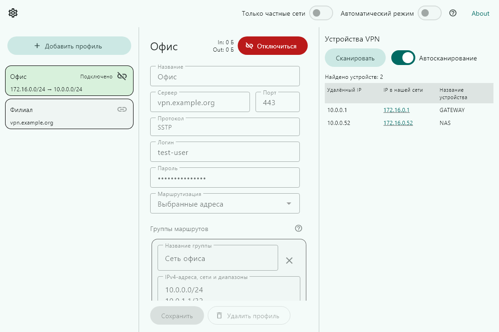

# Just better SSTP

**English** · [Русский](README.ru.md)

An SSTP VPN client for Windows. Choose which traffic goes through the VPN and connect to several networks at once, even when they use the same private addresses. The interface is currently in Russian.

**[Download for Windows x64 →](https://github.com/blackbox666/Just-better-SSTP-client/releases)**

- Control each VPN connection independently.
- Choose a full IPv4 tunnel, private networks only, or specific routes.
- Assign automatic or manual aliases to overlapping remote subnets.
- Import Windows SSTP profiles, store credentials securely on your device, and create encrypted backups.
- Discover devices on the configured networks of a connected profile.

## Getting started

1. Open [Releases](https://github.com/blackbox666/Just-better-SSTP-client/releases), download `Just-better-SSTP-…-windows-x64.zip` from **Assets**, and extract the entire archive.
2. If the Visual C++ runtime is missing, install the [Microsoft Visual C++ Redistributable x64](https://learn.microsoft.com/en-us/cpp/windows/latest-supported-vc-redist/).
3. Run `sstp_client.exe` as administrator so the app can create the VPN adapter and configure routes.
4. Add a profile or choose **Settings → Import from Windows** (**Настройки → Импорт из Windows**). Then connect to the profile.

## Move profiles to another PC

1. In version 0.1.1 or later, open **Settings → Store profiles in the app folder** (**Настройки → Хранить профили в папке приложения**) and set a password. The app saves your current profiles and future changes in the encrypted `sstp-profiles.sstpvault` file next to `sstp_client.exe`.
2. Close the app and copy the entire folder, including the `.sstpvault` file, to the other Windows PC.
3. Launch `sstp_client.exe`, select **Open profiles** (**Открыть профили**), and enter the same password.

The Windows x64 build is an unsigned preview tested on Windows 10. Platform releases for macOS, iOS, and Windows ARM64 are pending. This repository distributes ready-to-run builds.

Report bugs in [Issues](https://github.com/blackbox666/Just-better-SSTP-client/issues). Keep passwords, backup files, and private server details out of reports.
