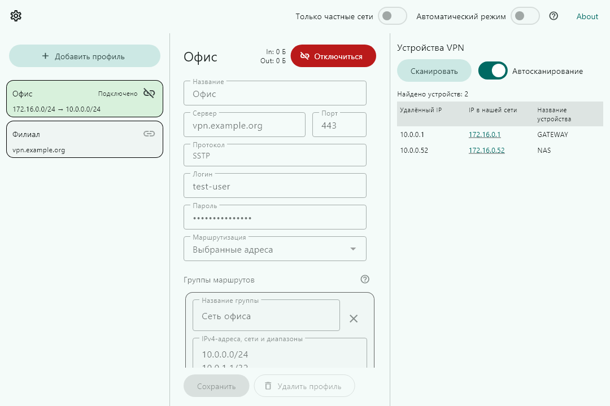

# Just better SSTP

[English](README.md) · **Русский**

Клиент SSTP VPN для Windows. Настройте, какой трафик идёт через VPN, и подключайтесь
к нескольким сетям одновременно, даже если у них совпадают локальные адреса.

**[Скачать Windows x64 →](https://github.com/blackbox666/Just-better-SSTP-client/releases)**

- Отдельное управление каждым VPN-подключением.
- Полный IPv4-туннель, только частные сети или выбранные маршруты.
- Автоматические и ручные псевдонимы для совпадающих удалённых подсетей.
- Импорт SSTP-профилей Windows, локальное защищённое хранение и зашифрованные резервные копии.
- Поиск устройств в настроенных сетях подключённого профиля.

## Как запустить

1. В разделе [Releases](https://github.com/blackbox666/Just-better-SSTP-client/releases) скачайте `Just-better-SSTP-…-windows-x64.zip` из списка Assets и распакуйте архив целиком.
2. Если среда Visual C++ ещё не установлена, скачайте [Microsoft Visual C++ Redistributable x64](https://learn.microsoft.com/en-us/cpp/windows/latest-supported-vc-redist/).
3. Запустите `sstp_client.exe` от имени администратора, чтобы приложение могло создать VPN-адаптер и настроить маршруты.
4. Добавьте профиль или выберите **Настройки → Импорт из Windows**. Затем подключите нужный профиль.

Первый выпуск — предварительная версия без цифровой подписи приложения. Проверки
проводились на Windows 10 x64; выпусков для macOS, iOS и Windows ARM64 пока нет.
Здесь публикуются готовые сборки; исходный код приложения не публикуется.

Об ошибках можно сообщить в [Issues](https://github.com/blackbox666/Just-better-SSTP-client/issues). Не прикладывайте пароли,
резервные копии и сведения о частных серверах.
